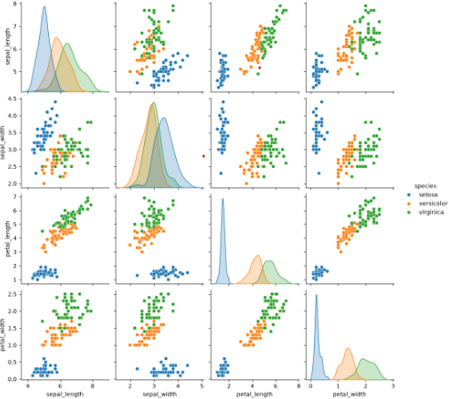
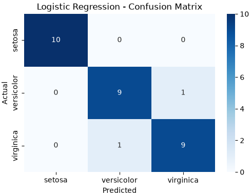

# 🌸 Multi-Class Benchmark Classification Pipeline – Iris Dataset

## 📌 Project Overview

This project implements an end-to-end supervised machine learning classification pipeline using the Iris dataset.

The objective is to analyze flower measurements and compare the performance of two classification algorithms:

- Logistic Regression
- Decision Tree Classifier

Both models are evaluated using multiple classification metrics to understand their predictive performance and compare their decision-making approaches.

## 📊 Dataset Description

The Iris dataset contains measurements of three different flower species:

- Setosa
- Versicolor
- Virginica

**Dataset Information:**
- Initial Records: 150
- Features: 4 numerical features
- Target Variable: Species
- Duplicate Records Identified: 1
- Records After Cleaning: 149

**Input Features:**
- Sepal Length
- Sepal Width
- Petal Length
- Petal Width

**Dataset Source:** [Iris Dataset – Seaborn](https://raw.githubusercontent.com/mwaskom/seaborn-data/master/iris.csv)

## 🛠️ Technologies & Libraries

- Python
- Pandas
- NumPy
- Matplotlib
- Seaborn
- Scikit-Learn
- Jupyter Notebook

## 🔄 Project Workflow

1. Data Loading and Inspection
2. Exploratory Data Analysis (EDA)
3. Statistical Summary and Data Distribution Analysis
4. Class Distribution Visualization
5. Pairplot Visualization
6. Duplicate Detection and Removal
7. Feature and Target Separation
8. Train-Test Split (80:20)
9. Feature Scaling using StandardScaler
10. Model Training:
   - Logistic Regression
   - Decision Tree Classifier
11. Model Evaluation
12. Confusion Matrix Analysis
13. Decision Boundary Visualization

## 🤖 Machine Learning Models

### 1. Logistic Regression
- Supervised classification algorithm.
- Trained using standardized features.
- Used to classify the three Iris species.

### 2. Decision Tree Classifier
- Tree-based supervised classification algorithm.
- Trained using the original feature values.
- Uses feature-based splits to classify flower species.

## 📈 Model Performance Comparison

Both models were evaluated using Accuracy, Weighted Precision, Weighted Recall and Weighted F1-Score.

| Evaluation Metric | Logistic Regression | Decision Tree |
|---|---:|---:|
| Accuracy | 93.33% | 93.33% |
| Weighted Precision | 93.33% | 93.33% |
| Weighted Recall | 93.33% | 93.33% |
| Weighted F1-Score | 93.33% | 93.33% |

**Test Results:** Both models correctly classified 28 out of 30 test samples.

## 🔍 Key Observations

- The dataset initially contained 150 records, including one duplicate record.
- Setosa was clearly distinguishable from the other two species.
- Versicolor and Virginica showed overlapping feature distributions.
- Both models achieved identical classification performance on the test dataset.
- Both models correctly classified all Setosa observations.
- The remaining misclassifications occurred between Versicolor and Virginica.
- Decision boundary visualizations highlighted the differences between linear and tree-based classification approaches.

## 📉 Visualizations

The Jupyter Notebook includes:

- Iris Species Distribution
  
  
- Pairplot for Feature Relationships
  This pairplot illustrates the relationships between
  sepal length, sepal width, petal length, and petal width
  across the three Iris species.
  
  
- Logistic Regression Confusion Matrix
  The model correctly classified 28 out of 30 test samples,
  achieving an accuracy of 93.33%.
  
- Decision Tree Confusion Matrix
- Logistic Regression Decision Boundary
- Decision Tree Decision Boundary

**Explore the complete notebook and visualizations:**

[View Interactive Notebook on NBViewer](https://nbviewer.org/github/saniasharmaa003-debug/datheon-iris-classification/blob/main/project1.ipynb)

## ⚙️ Installation & Execution

### Step 1: Clone the Repository

```bash
git clone https://github.com/saniasharmaa003-debug/datheon-iris-classification.git
```

### Step 2: Navigate to the Project Directory

```bash
cd datheon-iris-classification
```

### Step 3: Install Dependencies

```bash
pip install -r requirements.txt
```

### Step 4: Launch Jupyter Notebook

```bash
jupyter notebook
```

Open `project1.ipynb` and run the cells to explore the complete workflow.

## 📝 Conclusion

Both Logistic Regression and Decision Tree Classifier achieved 93.33% accuracy on the Iris dataset.

Although both algorithms delivered identical evaluation metrics, they use different approaches to classification.

Logistic Regression generates linear decision boundaries, whereas Decision Tree creates feature-based decision regions.

This project demonstrates a complete multiclass classification workflow, covering data exploration, preprocessing, model training, evaluation and visualization.

## 👩‍💻 Author

**Sania Sharma**

[GitHub Profile](https://github.com/saniasharmaa003-debug)

---

⭐ If you find this project interesting, feel free to explore the repository and notebook!
